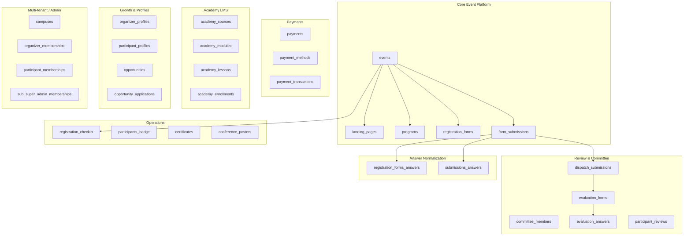
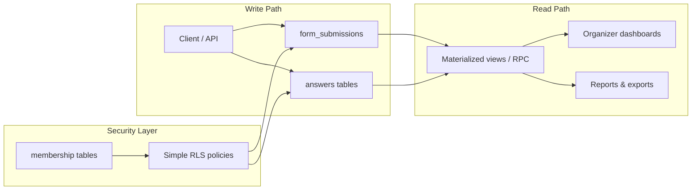

# Symposai Database Structure Evaluation Report

**Project:** sympos-ai (`gcgxgtixscwpiiuenlub`)  
**Platform:** Supabase (PostgreSQL)  
**Report date:** June 13, 2026  
**Scope:** Schema design, security posture, query/RLS performance, migration hygiene, and scalability recommendations  
**Method:** Live inspection via Supabase MCP, SQL catalog queries, Supabase Database Advisors (security + performance), and review of repository SQL scripts

---

## 1. Executive Summary

The Symposai database is a **feature-rich, multi-domain PostgreSQL schema** supporting conference/event management, registrations, submissions, peer review, certificates, payments, messaging, academy (LMS), opportunities, campus multi-tenancy, and super-admin governance. At **72 public tables**, **76 applied migrations**, **243 RLS policies**, and **305 indexes**, the schema reflects rapid product growth and broad functional coverage.

**Current scale is still small** (e.g. 4 events, 18 form submissions, 8 auth users), so most performance issues are **latent architectural risks** rather than active bottlenecks. However, several **security gaps are already critical** regardless of scale.

| Dimension | Rating | Summary |
|-----------|--------|---------|
| Functional coverage | Strong | Broad domain model supports the full Sympos-ia product surface |
| Relational integrity (core flows) | Mixed | Good FK usage in newer modules; legacy TEXT keys and JSON blobs weaken consistency |
| Security (RLS & auth) | Weak | 17 tables without RLS; policies exist but RLS disabled on 12; `user_metadata` used in policies |
| Query performance (at scale) | Moderate risk | 479 performance advisor findings; heavy RLS, JSON-in-TEXT, dual answer storage |
| Operability / maintainability | Moderate risk | Dual migration path (`scripts/` + Supabase migrations) increases drift risk |
| Scalability readiness | Moderate | Normalized subsystems exist, but hot paths still rely on denormalized blobs |

**Top priority (before scale):** Fix RLS enforcement, move roles out of `user_metadata`, and standardize event/submission relationships.  
**Top priority (before growth):** Reduce RLS policy overhead, finish answer normalization, convert JSON-in-TEXT to `jsonb`, and add targeted indexes on real query paths.

---

## 2. Database Snapshot

### 2.1 Connection & identity

| Property | Value |
|----------|-------|
| Project ref | `gcgxgtixscwpiiuenlub` |
| API URL | `https://gcgxgtixscwpiiuenlub.supabase.co` |
| Postgres extensions (installed) | `pgcrypto`, `uuid-ossp`, `pg_stat_statements`, `supabase_vault` |
| Applied migrations | 76 (Jan 2026 – Jun 2026) |
| Manual SQL scripts in repo | ~100 files under `scripts/` |

### 2.2 Scale metrics (live, Jun 2026)

| Metric | Count |
|--------|------:|
| Public tables | 72 |
| Tables with RLS enabled | 55 |
| Tables with RLS disabled | 17 |
| RLS policies | 243 |
| Indexes | 305 |
| Triggers | 40 |
| Storage buckets | 19 |
| Registered auth users | 8 |

### 2.3 Largest tables by on-disk size (not row count)

Even with low row counts, several tables already show structural bloat from wide schemas and TEXT/JSON payloads:

| Table | Row estimate | Total size |
|-------|-------------:|-----------:|
| `events` | 4 | 768 kB |
| `form_submissions` | 18 | 344 kB |
| `landing_pages` | 1 | 232 kB |
| `participant_reviews` | 2 | 176 kB |
| `committee_invitations` | 5 | 168 kB |

This indicates **wide rows and/or index overhead** early in the lifecycle — a signal that scale will amplify storage and scan costs unless normalized.

### 2.4 Column type distribution (public schema)

| Data type | Column count |
|-----------|-------------:|
| `text` | 342 |
| `uuid` | 217 |
| `timestamptz` | 147 |
| `jsonb` | 24 |
| `integer` | 24 |
| `boolean` | 20 |

**Observation:** The schema is overwhelmingly **TEXT-centric**. Structured configuration and answers are often stored as serialized JSON strings rather than native `jsonb`, which limits indexing, validation, and query pushdown.

---

## 3. Domain Architecture Overview

The database can be grouped into **11 functional domains**:



### 3.1 Well-normalized subsystems (strengths)

These areas follow relational best practices with clear parent-child hierarchies and foreign keys:

- **Academy LMS** — `academy_courses` → `modules` → `sections` → `lessons` → content blocks, quizzes, enrollments, progress
- **Payments** — `payments`, `payment_methods`, `payment_components`, `payment_transactions`, file attachments
- **Messaging** — `message_groups`, `messages`, attachments, read status
- **Opportunities** — `opportunities`, `opportunity_applications`, saved opportunities
- **Campus tenancy** — `campuses` with membership tables for organizers/participants/sub-super-admins

### 3.2 Legacy / hybrid subsystems (risk areas)

- **`events` hub table** — 47 columns mixing scalar fields, foreign keys, and many `*_ids` TEXT columns storing JSON-encoded ID lists (`committee_ids`, `evaluation_form_ids`, `badge_template_ids`, etc.)
- **`form_submissions`** — Central fact table with `event_id` as **TEXT** (no FK to `events.id`), plus legacy `answers` / `general_info` TEXT JSON alongside normalized answer tables
- **Form definitions** — `registration_forms.sections`, `fields`, `general_info`, `actions` stored as TEXT JSON
- **Landing pages** — entire page config stored as TEXT JSON in `landing_pages.config`

---

## 4. Pros — What the Database Does Well

### 4.1 Comprehensive product model

The schema maps closely to Sympos-ia's product modules: events, LP builder, registration, submissions, jury workflow, certificates, badges, check-in, academy, opportunities, payments, and super-admin campus governance. This **reduces application-side glue code** and keeps business entities queryable.

### 4.2 UUID primary keys throughout

Consistent use of UUID PKs simplifies client generation, merge-safe inserts, and distributed ID creation — appropriate for a Supabase/PostgREST architecture.

### 4.3 Foreign keys in newer modules

Recent domains (academy, payments, opportunities, conference posters) use explicit FK constraints. **All current FK columns use UUID types**, which is type-safe at the database layer.

### 4.4 Answer normalization initiative

The split into `registration_forms_answers` and `submissions_answers` (documented in `ANSWERS_TABLES_README.md`) is the **correct direction** for:

- Field-level filtering and reporting
- Targeted indexes (`submission_id`, `form_id`, `field_id`, `field_label`)
- Reduced need to parse full submission JSON blobs

### 4.5 RLS coverage intent

55 of 72 tables have RLS enabled, with **243 policies** reflecting granular access (organizer vs participant vs public slug views). The *intent* — defense-in-depth at the database layer — aligns with Supabase best practices.

### 4.6 Observability foundation

`pg_stat_statements` is installed, enabling future query performance analysis once traffic grows.

### 4.7 Migration history exists

76 sequential Supabase migrations provide an auditable evolution trail from Jan–Jun 2026. Feature additions (conference posters, opportunity module, check-in display fields) are tracked.

### 4.8 Index awareness

305 indexes exist, including domain-specific additions (e.g. participant submissions indexes, saved events index). The team clearly understands indexing — though cleanup is now needed.

---

## 5. Cons — Structural Weaknesses & Risks

### 5.1 Critical security: RLS disabled on exposed tables

**17 public tables have RLS disabled**, including high-sensitivity core tables:

| Table | Policies defined | RLS enabled | Risk |
|-------|-----------------|-------------|------|
| `events` | Yes (7) | **No** | Full read/write exposure via anon key |
| `form_submissions` | Yes (6) | **No** | Submission data exposed |
| `registration_forms` | Yes (5) | **No** | Form definitions exposed |
| `registration_forms_answers` | Yes (4) | **No** | Individual answers exposed |
| `submissions_answers` | Yes (4) | **No** | Submission field answers exposed |
| `evaluation_forms` / `evaluation_answers` | Yes | **No** | Review rubrics and scores exposed |
| `dispatch_submissions` | Yes (5) | **No** | Jury assignment data exposed |
| `participant_reviews` | Yes (4) | **No** | Review workflow exposed |
| `participant_profiles` | Yes (4) | **No** | PII exposed |
| `jury_members` | No | **No** | Committee/jury data exposed |
| `committee_invitations` | No | **No** | Invitation tokens/metadata exposed |
| `badge_templates` / `participants_badge` | Yes | **No** | Badge data exposed |
| `ngo_profile` | No | **No** | Profile data exposed |
| `event_attendance` | No | **No** | Attendance exposed |
| `committee_member_invitations` | No | **No** | Invitations exposed |

**12 tables have policies written but RLS not enabled** — a particularly dangerous state because it *looks* secured in migration scripts but is **not enforced at runtime**.

> **Impact:** Anyone with the Supabase anon key (embedded in the frontend) can potentially read or modify all rows in these tables via PostgREST.

### 5.2 Critical security: `user_metadata` used in RLS policies

Supabase Database Advisor flagged **ERROR-level** findings for policies referencing `auth.jwt() -> 'user_metadata'`, which is **user-editable** and must never gate authorization.

Affected tables include:

- `campuses`
- `organizer_memberships` / `participant_memberships`
- `sub_super_admin_memberships`
- `events` (multiple policies)
- `opportunities` / `opportunity_applications`

**Impact:** A user could potentially elevate privileges by modifying their JWT metadata client-side.

**Correct pattern:** Store roles in a dedicated table (e.g. `user_roles`) or use `auth.users.raw_app_meta_data` (server-only) — never `user_metadata`.

### 5.3 SECURITY DEFINER functions exposed to anon/authenticated

Functions callable via `/rest/v1/rpc/` without proper EXECUTE revocation:

- `auth_emails_existing(email_list text[])` — email enumeration risk
- `sync_committee_member_for_invitation_id(uuid)`
- `trg_sync_committee_member_on_invitation_accepted()`

### 5.4 Storage bucket listing exposure

**15 public buckets** allow broad SELECT listing on `storage.objects`, enabling directory-style enumeration of all files (badges, submissions, certificates, email attachments, etc.) even when direct URLs are unguessable.

### 5.5 JSON stored as TEXT instead of JSONB

342 `text` columns vs only 24 `jsonb` columns. Storing JSON as TEXT:

- Prevents GIN indexing on keys
- Forces application-side parsing on every read
- Blocks `@>`, `?`, `jsonb_path_query` operators in SQL
- Increases risk of invalid JSON slipping into production

Examples: `form_submissions.answers`, `registration_forms.fields`, `landing_pages.config`, `events.committee_ids`, `certificate_templates.elements`.

### 5.6 Dual answer storage (write amplification + consistency risk)

Per `ANSWERS_TABLES_README.md`, submissions are saved to **both**:

1. `form_submissions.answers` (JSON TEXT blob)
2. `registration_forms_answers` or `submissions_answers` (normalized rows)

This creates:

- **2× write cost** on every submission
- **Drift risk** if one path fails or legacy code reads the blob while new code reads normalized rows
- **Ambiguity** for reporting — which source is canonical?

Current row counts: 18 submissions, 21 registration answers, 11 submission answers — suggesting incomplete migration or mixed code paths.

### 5.7 Weak event ↔ submission relationship

`form_submissions.event_id` is **TEXT**, not a UUID FK to `events.id`. Consequences:

- No referential integrity (orphan submissions possible)
- Index on TEXT is less efficient than UUID FK joins
- Application must coerce types manually
- Same issue for `accepted_event_id TEXT`

Meanwhile, `dispatch_submissions.event_id` **does** FK to `events.id` — inconsistent patterns within the same workflow.

### 5.8 `events` as a configuration god table

The `events` table stores:

- Scalar metadata (name, deadlines, publish status)
- Single FK references (`landing_page_id`, `registration_form_id`, …)
- **Parallel legacy multi-select TEXT JSON columns** (`landing_page_ids`, `registration_form_ids`, `committee_ids`, …)

This dual single-ID + JSON-array pattern suggests **incomplete migration** from multi-value TEXT storage to relational junction tables. It increases row width, complicates queries, and makes indexing impossible on contained IDs.

### 5.9 RLS policy complexity & performance debt

Supabase Performance Advisor reported **479 findings**:

| Lint type | Count | Meaning |
|-----------|------:|---------|
| `multiple_permissive_policies` | 174 | Multiple permissive policies per role/action → each must be evaluated |
| `auth_rls_initplan` | 170 | `auth.uid()` not wrapped in subselect → re-evaluated per row |
| `unused_index` | 119 | Indexes consuming write/storage overhead with no usage |
| `unindexed_foreign_keys` | 15 | FK columns missing covering indexes → slow joins/deletes |
| `duplicate_index` | 1 | Redundant index maintenance |

With 243 policies across 72 tables, **every PostgREST query pays RLS overhead**. At current scale this is invisible; at thousands of submissions per event it becomes a primary bottleneck.

### 5.10 Unindexed foreign keys on hot paths

Tables missing FK indexes (partial list):

| Table | Unindexed FK columns (count) |
|-------|---------------------------|
| `events` | 5 (payment offers, forms, program, landing page refs) |
| `form_submissions` | 1 (`opportunity_application_id`) |
| `registration_checkin` | 1 (`form_submission_id`) |
| `participants_badge` | 1 (`badge_template_id`) |
| `opportunity_applications` | 1 |
| Academy / payment tables | several |

These will hurt JOIN and CASCADE DELETE performance as volume grows.

### 5.11 Dual migration workflow (drift risk)

Schema changes exist in **two places**:

1. **Supabase migrations** (76 applied, authoritative on remote)
2. **`scripts/*.sql`** (~100 manual scripts, many overlapping)

There is **no `supabase/migrations/` folder** in the repo — migrations appear applied directly to remote without full local version control sync. This makes:

- Reproducing environments difficult
- Code review of schema changes inconsistent
- Rollbacks risky

### 5.12 Over-indexing / unused indexes

119 indexes reported as unused. With only ~200 total rows across most tables, many indexes were likely **prematurely created** or created for hypothetical queries. Each unused index:

- Slows INSERT/UPDATE/DELETE
- Consumes buffer cache
- Increases backup size

### 5.13 Function hardening gaps

Multiple trigger/helper functions have **mutable `search_path`** (security advisor WARN), which is a known PostgreSQL hardening concern for SECURITY DEFINER functions.

### 5.14 Auth configuration

Leaked password protection (HaveIBeenPwned check) is **disabled** in Supabase Auth settings.

---

## 6. Performance Analysis

### 6.1 Current state: healthy but misleading

At ~8 users and tens of submissions, query latency is dominated by network and client-side JSON parsing — not Postgres. **Do not optimize based on today's timings alone.** Optimize based on **access patterns at target scale** (e.g. 500 events, 50k registrations, 200k submission answers).

### 6.2 Predicted hot paths at scale

| Workflow | Tables touched | Current risk |
|----------|---------------|--------------|
| Organizer dashboard — event submissions list | `form_submissions`, `events`, answer tables | TEXT `event_id`, JSON blob reads, RLS subqueries |
| Jury review queue | `dispatch_submissions`, `form_submissions`, `participant_reviews` | Complex participant visibility policies, RLS initplan issues |
| Registration check-in scan | `registration_checkin`, `form_submissions`, answer tables | Missing FK index on checkin → submission |
| Public event page | `events`, `landing_pages`, `programs` | Wide `events` row fetch, large `config` TEXT |
| Certificate generation | `certificates`, `certificate_templates`, `form_submissions` | Template JSON in TEXT, storage I/O |
| Opportunity applications funnel | `opportunities`, `opportunity_applications`, `form_submissions` | JSON steps config, RLS with metadata |
| Academy course browse | 10+ academy tables | Deep joins; mostly well-structured |

### 6.3 RLS as the primary scalability ceiling

With **174 multiple-permissive-policy** warnings and **170 auth_rls_initplan** warnings, list queries returning hundreds of rows will evaluate hundreds of policy expressions. Example problematic patterns:

- Participant visibility through EXISTS subqueries on `dispatch_submissions`
- Organizer + campus admin + public slug policies stacked on `events`
- Per-row `auth.uid()` calls without `(select auth.uid())` optimization

**Estimated impact at 10k+ rows:** 2–10× slower SELECT vs equivalent service-role query, depending on policy complexity.

### 6.4 JSON-in-TEXT parsing tax

Application services (e.g. `evaluationAnswerService.ts`, `geminiService.ts`) parse JSON from TEXT on **every read**. Some services even fetch up to 1000 submissions and filter in memory — a pattern that **will not scale**.

The normalized answer tables exist but are not yet the single source of truth across all code paths.

### 6.5 Storage I/O separation

19 buckets with public listing policies mean file operations may become a **bandwidth and enumeration** concern separate from Postgres performance. Large submission files in `Sub_Files` should not be loaded during routine submission list queries.

---

## 7. Security vs Performance Trade-offs

| Approach | Security benefit | Performance cost |
|----------|-----------------|-----------------|
| Enable RLS everywhere | Critical — blocks anon abuse | Moderate — policy evaluation per row |
| Complex participant dispatch policies | Fine-grained access | High — nested EXISTS across 3+ tables |
| SECURITY DEFINER RPC functions | Bypass RLS for controlled ops | Low per call, but risky if over-exposed |
| Public storage buckets | Simple CDN-style access | Enumeration + bandwidth exposure |
| JSON blobs in submissions | None | Hides data from SQL but forces app parsing |

**Recommendation:** Do not disable RLS for performance. Instead, **simplify policies**, use **security definer RPCs sparingly** for complex reads, and add **materialized views or summary tables** for organizer dashboards.

---

## 8. Recommendations — How to Make the Database More Performant

Prioritized by impact. **No implementation in this report — planning only.**

### Phase 0 — Immediate (security blockers, minimal performance impact)

1. **Enable RLS** on all 17 exposed tables — starting with `events`, `form_submissions`, `registration_forms`, answer tables, evaluation tables
2. **Remove `user_metadata` from all policies** — replace with membership/role tables already partially present (`organizer_memberships`, etc.)
3. **Revoke EXECUTE** on sensitive SECURITY DEFINER functions from `anon` role
4. **Tighten storage policies** — remove bucket listing SELECT policies where direct URL access suffices
5. **Enable leaked password protection** in Supabase Auth

### Phase 1 — Structural fixes (high performance + integrity ROI)

1. **Migrate `form_submissions.event_id` from TEXT → UUID FK**  
   - Backfill from valid UUID strings  
   - Add index `idx_form_submissions_event_id_uuid`  
   - Same for `accepted_event_id`

2. **Pick one canonical answer store**  
   - Recommended: normalized tables as source of truth  
   - Deprecate `form_submissions.answers` (keep nullable during transition)  
   - Update all services to stop dual writes

3. **Convert high-traffic JSON TEXT columns to JSONB**  
   Priority columns:  
   - `registration_forms.fields`, `sections`  
   - `landing_pages.config`  
   - `evaluation_forms` structure fields  
   - `events.fields`, `dates`, `links` (where queried)

4. **Replace `events.*_ids` TEXT JSON arrays with junction tables**  
   Example: `event_committees(event_id, committee_id)`, `event_evaluation_forms(event_id, form_id, sort_order)`  
   Enables indexed lookups instead of string parsing.

### Phase 2 — RLS performance optimization

1. **Fix `auth_rls_initplan`** — rewrite policies using `(select auth.uid())` pattern (170 policies)
2. **Consolidate multiple permissive policies** — merge into single policy per table/action/role where possible (174 cases)
3. **Replace deep EXISTS chains** with:
   - Precomputed membership flags on `form_submissions` (e.g. `assigned_reviewer_ids uuid[]` with GIN index), or
   - SECURITY DEFINER RPC `get_my_review_queue(user_id)` returning only authorized rows
4. **Add partial indexes** for common filters:  
   - `form_submissions(event_id, approval_status)`  
   - `form_submissions(event_id, submission_pipeline_kind)`  
   - `dispatch_submissions(event_id, reviewer_id)`  
   - `events(public_slug) WHERE publish_status = 'published'`

### Phase 3 — Index hygiene

1. **Add indexes on the 15 unindexed FK columns** (especially on `events` and `registration_checkin`)
2. **Drop or defer unused indexes** — validate with `pg_stat_user_indexes` after 30 days of production traffic before removing
3. **Remove the 1 duplicate index** flagged by advisor
4. **Add composite indexes aligned to actual PostgREST query patterns** (inspect via `pg_stat_statements`)

### Phase 4 — Query & API layer patterns

1. **Stop in-memory filtering** of submission JSON (seen in AI assistant services) — push filters to SQL via normalized answer columns or generated columns
2. **Use selective column projection** — never `select *` on wide tables like `events` or `landing_pages` for list views
3. **Paginate all list endpoints** — cursor-based on `(created_at, id)`
4. **Introduce read models** for heavy dashboards:  
   - `event_submission_stats_mv` (submission counts by status)  
   - `reviewer_workload_mv` (open reviews per jury member)  
   Refresh on schedule or via trigger debounce.

### Phase 5 — Operational excellence

1. **Consolidate migrations** — move all `scripts/*.sql` into versioned `supabase/migrations/` and pull remote history into repo
2. **Enable Supabase Index Advisor extension** (`index_advisor`) for workload-driven recommendations
3. **Set up query monitoring dashboards** using `pg_stat_statements` — track top 20 queries by total time
4. **Define retention/archival policy** for old submissions, messages, and audit logs before row counts reach six figures
5. **Consider table partitioning** only when single-table rows exceed ~1–5M (likely `form_submissions`, answer tables, `messages`)

### Phase 6 — Advanced (future scale)

1. **Read replicas** via Supabase for reporting/analytics workloads
2. **Edge caching** for public event/opportunity slug pages (data changes infrequently)
3. **Background job queue** (`pgmq` extension available but not installed) for certificate PDF generation, bulk email, CSV exports
4. **Full-text search** (`pg_trgm` or `pgroonga`) for submission title/abstract search if not already handled in app layer

---

## 9. Suggested Target Architecture (Conceptual)



**Principles:**

- **Normalize what you filter on** (status, event_id, field answers, reviewer assignments)
- **JSONB what you render but rarely filter** (landing page layout, certificate template design)
- **Keep RLS policies dumb and fast** — complex authorization in SECURITY DEFINER RPCs or membership tables
- **One migration path, one source of truth**

---

## 10. Module-Level Scorecard

| Domain | Design | Security | Performance readiness | Notes |
|--------|--------|----------|----------------------|-------|
| Events & landing pages | C | D | C | God table, RLS off, TEXT JSON arrays |
| Registration & submissions | C+ | D | C | Dual answer storage, TEXT event_id |
| Review & dispatch | B- | D | C- | Good workflow model, RLS off, heavy policies |
| Certificates & badges | B | B- | B | Mostly RLS on; storage listing risk |
| Check-in | B | B | B- | Missing FK index on submission |
| Academy LMS | A- | B+ | B+ | Best-normalized module |
| Payments | A- | B+ | B | Clean relational model |
| Messaging | B+ | B | B | Standard pattern |
| Opportunities | B | C | B | Good schema; metadata in RLS |
| Campus / super-admin | B- | D | B | Membership tables good; metadata RLS bad |
| Conference posters | B+ | B+ | B+ | Recent, clean migration |
| Storage | B- | C | B | Too many listable public buckets |

*Grades reflect structural readiness at scale, not current production load.*

---

## 11. Conclusion

The Symposai database is **functionally ambitious and directionally sound** — especially in newer modules (academy, payments, opportunities, posters). The team has already started the right migration toward normalized answers and UUID-centric relationships.

However, the database carries **significant legacy debt** in its core event/submission path: JSON-as-TEXT, dual answer storage, TEXT foreign references, disabled RLS with policies present, and overly complex RLS that will not scale cleanly.

**The good news:** Current data volume is small, so fixes can be applied **before pain arrives**. The highest-return sequence is:

1. Security hardening (RLS + roles)
2. Integrity fixes (UUID FKs, single answer source)
3. RLS simplification + index alignment
4. Migration workflow consolidation

Once these are addressed, the schema is well-positioned to support Sympos-ia's multi-module conference platform through meaningful growth without a ground-up redesign.

---

## Appendix A — Tables with RLS Disabled

```
badge_templates, committee_invitations, committee_member_invitations,
dispatch_submissions, evaluation_answers, evaluation_forms,
event_attendance, events, form_submissions, jury_members,
ngo_profile, participant_profiles, participant_reviews,
participants_badge, registration_forms, registration_forms_answers,
submissions_answers
```

## Appendix B — Applied Migration Timeline Summary

- **Jan 2026:** Email templates, events enrichment, evaluation forms, participant reviews/profiles, LaTeX, badges, check-in
- **Feb 2026:** Presenter tables, saved/shared events, programs, NGO, payments, messaging, professor profiles
- **May–Jun 2026:** Payment offers on events, evaluation toggles, landing page CTA/topics, committee invitation sync, certificates PDF, check-in display, conference posters

## Appendix C — Data Sources Used

- Supabase MCP: `list_tables`, `list_migrations`, `list_extensions`, `get_advisors`, `execute_sql`
- Repository: `scripts/setup-supabase-tables.sql`, `scripts/create-answers-tables.sql`, `ANSWERS_TABLES_README.md`
- Application services: form answer, evaluation, registration submission services

---

*This report is evaluative only. No schema changes were applied.*
